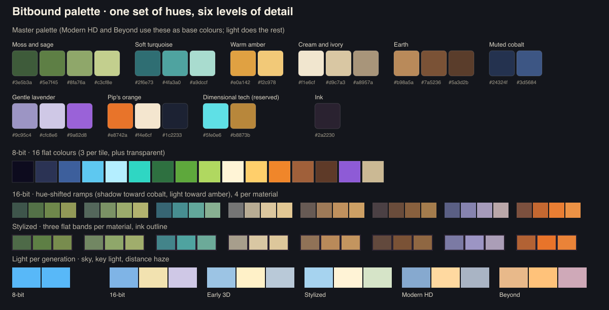
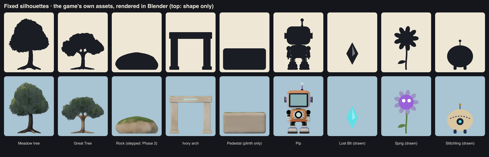
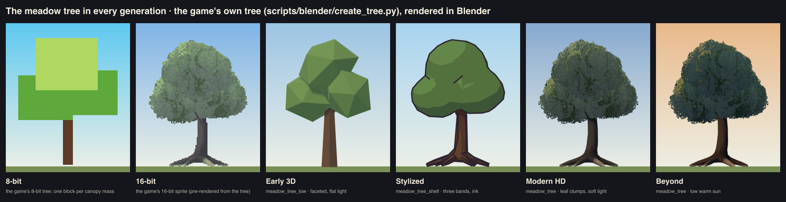

# Bitbound art bible

**Status:** Phase 1 built (2026-11-18). The painted materials, the one tree in every generation, the palettes and
the per-generation looks are in the game. The sheets in `docs/art/` are rendered in Blender from the game's own
assets (`scripts/blender/render_bible.py`, composited by `scripts/art-bible-sheets.mjs`); Sprig, the Stitchling and
the Lost Bit are not modelled yet and are drawn there, labelled so. "Today" in section 2 means before Phase 1.

Companion documents: `docs/CHAPTERS.md` (story, chapters, regions), `docs/benchmark/README.md` (the
six-generation benchmark).

---

## 1. Direction: a storybook that remembers

Bitbound is a premium, handcrafted, stylized platformer: playful in subject, mature in presentation. The quality
bar is the craft of the best modern character platformers and animated features. That means composed frames,
readable shapes, materials that look made by hand, and light that tells you where to go. It does not mean copying
any of their designs.

**The one rule:** the world is drawn once and redrawn six times with growing skill. Shapes never change between
generations; only the amount of information does.

| Generation | What it adds |
|---|---|
| 8-bit | Colour blocks |
| 16-bit | Shading and layers |
| Early 3D | Volume |
| Stylized | The true shape, line and paint |
| Modern HD | Material and light |
| Beyond | Life |

**Beyond is more beautiful, never more photographic.**

---

## 2. Where the art stands today

The renderers work and stay. The art direction is unfinished. Evidence: `docs/benchmark/baseline-sheet.jpg` (the
shard ruins in every generation, captured from the game on 2026-11-18).

| Problem | What the baseline shows |
|---|---|
| **One tree, four species** | 8-bit draws a block-capped tree, 16-bit a leafy round tree, Early 3D a **cone conifer**, Stylized a lollipop, Modern HD and Beyond a leaf-card tree. Nothing carries across. |
| **Photographic textures on primitive shapes** | Ground, rock, masonry and bark are Poly Haven photo scans projected onto boxes and sheer extruded cliffs. |
| **Two styles in one frame** | Scanned masonry and grass sit next to toy-like characters (the googly-eyed flower, the block enemy). |
| **16-bit and Early 3D derive from the scans** | 16-bit tiles are cut from the scans and reduced to 12 colours. Early 3D posterises the same scans, giving mustard and olive mush. |
| **Stylized has no value range** | The whole frame is light lime green; the path, grass and hills merge. |
| **Modern HD and Beyond are dark and noisy** | Dense uniform grass clumps fill half the frame, and Beyond is barely distinguishable from HD. |
| **Stone changes colour** | The ruin arch is lilac in 8-bit, grey-brown elsewhere. |
| **Several retro objects aren't sprites** | The machine, sign, bits, enemies and checkpoints are 3D meshes snapped to the pixel grid (see `docs/GRAPHICS_REPORT.md`). |
| **Terrain reads as blocks** | Raised sections are mesas with sheer walls. |
| **Readability in 3D** | At the benchmark camera, the flower fills the left third of every 3D frame. |

**Conclusion:** one authored art kit with fixed silhouettes and one palette, from which every generation is derived.
No new renderer is needed.

---

## 3. Palette

The palette is fixed for the whole game: every generation draws from the same hues.

| Family | Use |
|---|---|
| Moss and sage greens | Foliage, grass, moss on stone. The world's main colour. |
| Soft turquoise | Water, and the far distance in clear weather. |
| Warm amber and honey | Sunlight, highlights, lanterns, autumn accents. |
| Cream and ivory | All ancient stone. |
| Earth | Paths, soil, bark. |
| Muted cobalt | Shadows. Shadows lean blue, never grey or black. |
| Gentle lavender | Atmospheric distance, flowers, Sprig. |
| Pip's orange (with cream and his dark screen) | **Pip only.** Nothing else in the world is that orange, so he always reads. |
| Cyan and brass | **Dimensional technology only**: the shard, the core, Bits, glyph inlays, the wheel. |
| Ink | Outlines in Stylized, and the darkest pixel in the retro generations. |

**Rules:**
- Cyan anywhere means "this matters to the Frame". It is never decoration.
- Value structure in every frame: the play lane is mid-light, the background lighter and cooler, the foreground
  darker. Pip and the next thing to reach are the highest contrast.
- Hue-shifted ramps: shading moves toward cobalt and lighting toward amber. Shading never just darkens to grey.

**Per generation:**
- **8-bit:** 16 flat colours, at most 3 per tile or sprite plus transparency. This re-tunes today's 16
  (`PALETTE_8` in `src/game/render/post/Pipeline.ts`): moss greens and ivory replace one of the three blues and
  the brick red.
- **16-bit:** 4-step ramps per material from the same hues, at most 12 colours per tile and 16 per sprite.
- **Early 3D:** master hues as vertex and texture colours, plus a coloured fog.
- **Stylized:** 3 flat bands per material, plus ink.
- **Modern HD and Beyond:** the master hues are base colours; light does the rest.

---

## 4. Shape language and fixed silhouettes

| Kind | Shapes |
|---|---|
| Nature | Soft and rounded. Canopies are clumped masses; rock is stepped with rounded edges; ground rolls. No straight horizons, no sheer extruded walls. |
| Ancient architecture | Ivory stone in large chamfered blocks, slightly settled and worn, with moss in the joints. Carved with the Keeper's six-part emblem. |
| Dimensional technology | Thin, precise geometry: rings, diamonds, inlaid lines, in cyan and brass. Never neon tubes, never screens. |
| Characters | Rounded, chunky, big heads and feet, readable at 16 pixels tall. |

**The fixed silhouettes** must be recognisable in all six generations, and the benchmark checks this:

| Object | Silhouette |
|---|---|
| Meadow tree | Three stacked rounded canopy masses on a slightly leaning trunk. The only common tree, in every generation. |
| Great Tree | A wide crown over a split, buttressed trunk. Landmark of Pixel Meadow and the ending. |
| Stepped rock | Rounded steps that read as climbable ledges. |
| Ivory arch | Two columns, a lintel and the emblem. |
| Shard pedestal | A stepped plinth with a floating diamond and a brass ring. |
| Lost Bit | A cyan diamond. |
| Pip | As today: rounded-square head, dark screen, cyan eyes, antenna, orange and cream body, big boots. |
| Sprig | A purple flower with a round face. |
| Stitchling | A round cream body with a stitched seam, one eye and a brass antenna. |

How the same tree is drawn by each generation (the game's own tree, rendered in Blender):

---

## 5. Visual specification per generation

| | 8-bit | 16-bit | Early 3D | Stylized | Modern HD | Beyond |
|---|---|---|---|---|---|---|
| **Resolution** | about 240 rows, whole-number scale (today) | about 224 rows (today) | full, with a 2× pixel snap on textures | full | full | full |
| **Colour** | 16 colours, 3 per tile | 4-step ramps, ≤12 per tile | master hues, coloured fog | 3 bands plus ink | base colours under real light | as HD, graded warm |
| **Geometry** | 16×16 tiles and sprites | 24×24 tiles, pre-rendered sprites | the master shapes decimated to faceted low-poly | master shapes | master shapes with full detail | plus extra detail layers |
| **Texture** | none | painted tiles | 64 px bakes, nearest filtered | flat painted colour | painted-look baked materials | plus detail maps, moss, wet edges |
| **Light** | none | painted into the ramps | vertex lighting | banded, one key light | sun, sky light, soft shadows, ambient occlusion | golden hour, haze kept behind the lane, light through leaves |
| **Motion** | 2-frame loops | 4- to 6-frame loops, parallax | vertex wobble, stiff swaying | squash and stretch, bouncy | full wind and water | wind, falling leaves, creatures, reflective water |
| **Effects** | none | none | none | ink only | bloom, ambient occlusion, mild depth haze | plus light shafts, gentle grade; no depth-of-field over play |

### Per-generation notes

- **8-bit.** A lost 1985 platformer, honestly made. Every object is an authored sprite, including the machine,
  sign, Bits, enemies and checkpoints, which today are snapped meshes. The meadow tree is the bible silhouette in
  two greens and a trunk. Ground tiles are grass-topped earth in moss and earth, not brick red. The ruin is ivory.
- **16-bit.** The same layout, painted with care. Tiles are painted by script from the palette ramps rather than
  cut from photo scans. Three parallax layers (lavender hills, sage forest, a soft sky), animated water and
  waterfalls, swaying foliage frames. Sprites are still pre-rendered from the master models (today's pipeline),
  reduced to the ramps.
- **Early 3D.** A charming late-90s world, not a damaged one. Faceted versions of the master shapes (the tree is
  the same three masses as facets, not a cone). Small textures painted from the palette, vertex lighting, a short
  draw distance into coloured fog, vertex wobble. Colours clean and saturated, never posterised mush.
- **Stylized.** The world as its designers imagined it: master shapes, three flat bands, ink outlines, a painted
  sky. Clear values: lane mid-light, background pale, foreground darker. Grass is drawn as shapes, not noise.
- **Modern HD.** A premium console platformer in late afternoon. Painted-look materials (broad colour, soft
  gradient, worn edges) under real light. Grass is clumped and placed with intent, thinned along the lane edge
  so the path reads. Animated foliage and water.
- **Beyond.** A playable animated film at golden hour. Everything in Modern HD, plus life (wind through all
  foliage, drifting leaves and seeds, butterflies, fish, reflective water), richer secondary motion on Pip and
  Sprig, light through leaves, moss and small story details, and haze used for depth behind the lane only.

---

## 6. Characters and creatures across generations

| | 8-bit | 16-bit | Early 3D | Stylized | Modern HD | Beyond |
|---|---|---|---|---|---|---|
| **Pip** | 16×16 sprite, 3 colours (today) | pre-rendered sprite (today) | faceted model, stiff limbs | outlined, squashy | the Blender model, baked materials (today) | plus clearcoat, scratches, seams (today) and more face animation |
| **Sprig** | 16×16 flower, 2-frame bob | more petals, 4 frames | faceted petals, turns to face Pip | bouncy, outlined | soft petals, wind | velvet petals, secondary motion |
| **Stitchling** | 16×16, one-eye blink | seam detail | faceted ball | outlined, squash | cream ceramic, brass | plus wear and a glow behind the seam |
| **Lost Bit** | 8×8 diamond, 2 frames | 4-frame spin | spinning octahedron | outlined diamond | cut crystal | crystal with inner light |
| **Keeper emblem** | 1-colour glyph | inlaid glyph | carved | carved and inked | carved, cyan inlay | inlay with flowing light |

Today's googly-eyed flower (the "bloomer") becomes Sprig's species: fewer of them, placed as characters, not
decoration. Today's block enemy (`Glitchling`) is replaced by the Stitchling with the same behaviour.

---

## 7. Environment kit

| Element | Rule |
|---|---|
| Trees | One meadow-tree design in three sizes, one Great Tree, and one forest tree for the Painted Woods (taller, the same clumped masses). No cones, no lollipops. |
| Terrain | The path's heights in `src/game/level/valley.ts` stay exactly (collision is untouched). Off the path, sheer mesas become stepped rock with rounded ledges and grass caps. |
| Rock | Stepped, rounded, ivory-to-warm-grey with moss on top faces. No photo scans. |
| Ground cover | Clumps placed in drifts, thinned along the lane edge; flowers in small colour groups (lavender, honey, cream). |
| Water | Turquoise, with foam at edges and falls. 16-bit: animated tiles. Beyond: reflective. |
| Architecture | Ivory block kit: block, arch, column, pedestal, wall, gatehouse. Emblem carved on key pieces. |
| Dimensional tech | Cyan and brass: rings, diamonds, inlays, the wheel. |
| Sky | Per generation: flat (8-bit), banded (16-bit), gradient with fog (Early 3D), painted (Stylized), HDRI (HD, Beyond; today). |

---

## 8. Lighting and atmosphere

- One sun, from the west and behind the camera's left, in every 3D generation, so shadows fall the same way.
- Haze and fog only behind the play lane. Today's Beyond reveal shot drowned in haze; that is the failure to avoid.
- Modern HD: late afternoon, neutral-warm. Beyond: golden hour, warmer, longer shadows, light shafts.
- Interiors (the Hidden Chamber, the archive): dark, lit by cyan technology and shafts from above (today).

---

## 9. Animation

Pip's animation is snappy, with anticipation and squash, and expressive in the face (screen eyes). Later
generations add secondary motion (antenna lag, boot squash, a lean into turns) rather than different poses. Ambient
motion grows with the generation: 2-frame loops, then 4- to 6-frame loops, then stiff sway, bounce, natural wind,
and finally continuous life.

---

## 10. Interface per generation

The layout and hierarchy stay fixed; only the skin changes (today: six HUD skins in `src/ui/HUD.tsx`). Direction
from here: calmer and more minimal. The HUD shows Pip's status, Lost Bits, generation, perspective and one
contextual prompt. 8-bit uses pixel type and should be drawn into the pixel frame; Beyond uses thin linework. Menus
keep the scenic title with Pip in the current generation.

---

## 11. Avoid

Photographic or scanned surfaces, generic asset-pack props, cyberpunk, neon, horror, glossy plastic, mobile-game
UI, random scatter, floating platforms without a reason, sheer featureless cliffs, depth-of-field over play, and
haze in front of the action.

---

## 12. Asset production

- **One master per object.** Each object is built by script in Blender at Beyond quality with a painted-look
  baked material. Every other generation is derived from it:
  - **decimated:** Early 3D;
  - **flat-banded:** Stylized;
  - **pre-rendered and reduced:** 16-bit;
  - **traced:** 8-bit sprites, drawn by hand in code from the 16-bit render.
- **Production order:**
  1. meadow tree;
  2. stepped rock and cliff face;
  3. ground and path materials;
  4. ivory stone kit;
  5. Lost Bit and shard;
  6. grass, flowers, fern;
  7. Great Tree;
  8. water;
  9. Stitchling, then Sprig;
  10. region sets.
- **Reused as is:**
  - the per-generation material system (`src/game/render/eraMaterial.ts`) and model swapping (`eraSwap.ts`);
  - the retro renderers (`render/retro/`);
  - the 16-bit pre-render (`scripts/blender/render_sprites16.py`, `scripts/textures/sprites16.mjs`);
  - the build, optimise and validate scripts;
  - wind, sky, post-processing, the camera and all game rules.
- **Replaced:**
  - the scanned colour textures;
  - the four different trees;
  - the box-and-scan stonework;
  - 16-bit tiles cut from scans;
  - snapped meshes standing in for 8-bit sprites.
- **Budgets:** 15 MB of shipped assets (13.8 MB today). Beyond within today's GPU time (p95 about 12.7 ms on the
  reference machine): new detail must replace cost.
- **Ceiling:** every model is made by code, not sculpted. The benchmark shows early how far that goes. If it falls
  short, hand-made or commissioned models can come in through the same pipeline.

---

## 13. How the art is checked

- **Silhouette check:** the fixed objects, filled black, in all six benchmark frames, must be recognisably the
  same shape.
- **Palette check:** 8-bit and 16-bit frames contain only palette colours. A test already reads 8-bit frames back;
  it extends to 16-bit.
- **Readability check:** in every frame, Pip and the next landing surface are the highest-contrast things on
  screen. Existing tests keep the lane clear of occluders.
- **Budget check:** the asset size and GPU time are measured, not estimated.
- **Your approval:** of the benchmark sheet before anything is rolled out.
