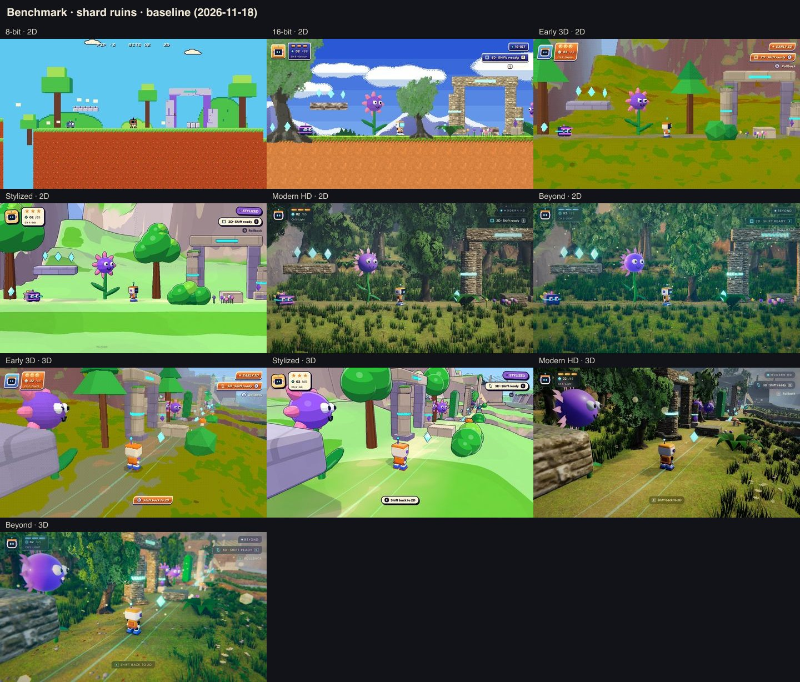
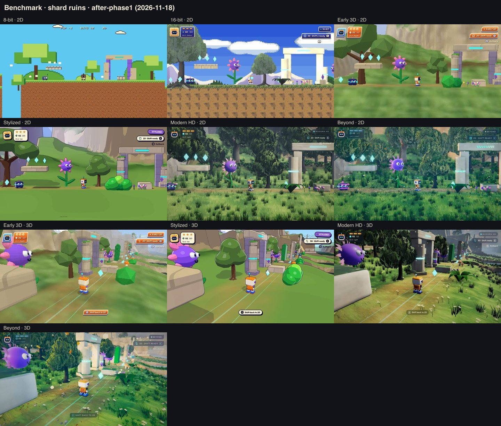

# Six-generation benchmark

The benchmark proves the art direction in `docs/ART_BIBLE.md` on one scene before it is rolled out to the rest of
the game.

**Scene:** the shard ruins in Pixel Meadow (x 22–34). It is the one place that holds everything the benchmark needs:
- Pip;
- meadow trees;
- the floating stone ledge (the terrain formation);
- the ivory arch and the shard pedestal (the dimensional artifact);
- a row of Lost Bits;
- the route: ground, a ledge, the pedestal.

**Frames:** the same spot (Pip at x 27) and framing in all six generations in 2D, and from a fixed orbit behind Pip
in the four 3D generations.

**Capture:** `node scripts/capture-benchmark.mjs <name>` with the dev server running on port 5179. One browser page,
ten frames, then a contact sheet.

## Baseline (today, before the restyle)

Frames: `baseline/2d-0.jpg` … `baseline/3d-5.jpg`.

What each step changes **today**, read from the frames:

| Step | What changes | Problem |
|---|---|---|
| 8-bit → 16-bit | The blocky tree becomes a leafy round tree; the lilac arch becomes scanned grey stone; painted parallax mountains appear; the ground goes from brick to orange | The tree changes species and the stone changes colour |
| 16-bit → Early 3D | Trees become **cones**; ground becomes posterised olive and mustard | A third species; muddy values |
| Early 3D → Stylized | Trees become lollipops; everything goes pale lime | A fourth species; no value range |
| Stylized → Modern HD | Leaf-card trees; scanned stone and grass; dark frame | Photographic surfaces next to toy-like characters |
| Modern HD → Beyond | Warmer haze, a little more glow | Barely different from Modern HD |
| 3D frames | The flower fills the left third of the frame | Readability |

## After Phase 1 (2026-11-18)

Before and after side by side, frame by frame: `compare-phase1.jpg`.

What each step changes **now**, read from the frames:

| Step | What changes |
|---|---|
| 8-bit → 16-bit | The tree keeps its three masses, now shaded; the arch is ivory in both; soil goes from flat brown to ramped soil with pebbles; lavender ranges and sage hills appear behind |
| 16-bit → Early 3D | The same masses as facets; clean greens and lavender fog instead of olive mush |
| Early 3D → Stylized | The true smooth masses, three bands and ink; palette ground with real values |
| Stylized → Modern HD | Leaf-clump canopies; painted ivory stone under real light; grass in drifts |
| Modern HD → Beyond | Warm grade, falling leaves, butterflies, dappled forest floor, no play blur |

Still open (details in `docs/GRAPHICS_REPORT.md`):
- Modern HD and Beyond are close in still 2D frames.
- The 8-bit columns have purple shading.
- The flower fills the left of the 3D frames at this camera.

## Target (Phase 1)

What each step should change, per the bible:

| Step | Adds |
|---|---|
| 8-bit → 16-bit | Ramps (4 shades per material), three parallax layers, animated water and foliage. Same tree, same ivory arch. |
| 16-bit → Early 3D | Volume: the same shapes as faceted low-poly, small painted textures, vertex light, coloured fog. |
| Early 3D → Stylized | The true smooth shapes, three flat bands, ink outlines, clear values. |
| Stylized → Modern HD | Painted-look materials under real sun and sky light, soft shadows, wind. |
| Modern HD → Beyond | Golden hour, light through leaves, haze behind the lane only, drifting leaves, creatures, richer motion. |

**Phase 1 is accepted when:**
- you approve the restyled sheet;
- the meadow tree, the arch, the pedestal, the ledge, the Bit and Pip are recognisably the same silhouette in all
  ten frames;
- the 8-bit and 16-bit frames contain only palette colours;
- Pip and the next landing surface are the highest-contrast things in every frame;
- all unit tests pass.
